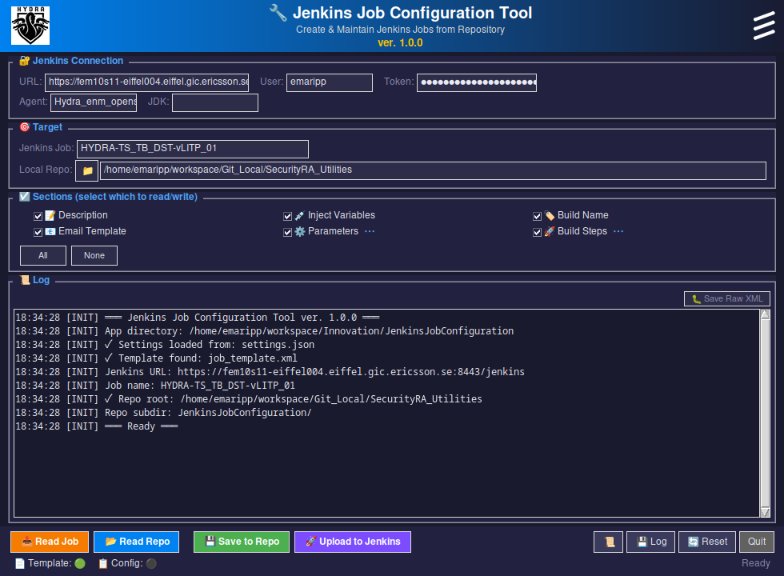
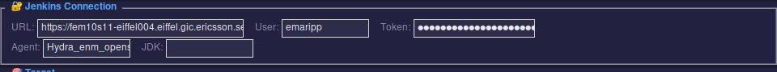
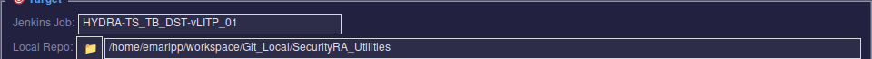
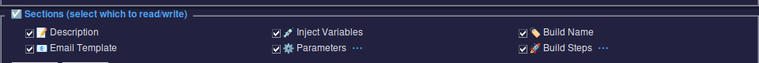
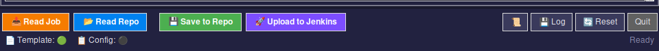
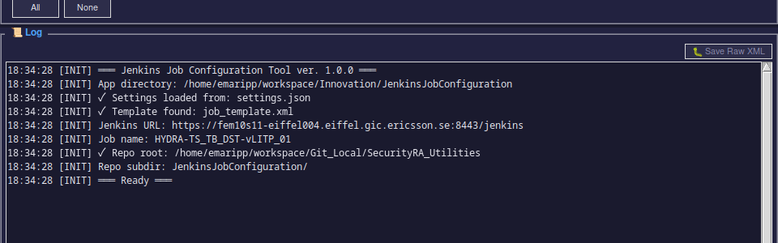

# Jenkins Job Configuration Tool — Guida Utente

---

## Indice

1. [Introduzione](#introduzione)
2. [Perché questo tool](#perché-questo-tool)
3. [Architettura](#architettura)
4. [Installazione](#installazione)
5. [Guida Rapida](#guida-rapida)
6. [Prima Configurazione](#prima-configurazione)
7. [Interfaccia Utente](#interfaccia-utente)
8. [Flussi di Lavoro](#flussi-di-lavoro)
9. [Sezioni e Parametri](#sezioni-e-parametri)
10. [Sistema Template](#sistema-template)
11. [Impostazioni](#impostazioni)
12. [Struttura File nel Repository](#struttura-file-nel-repository)
13. [Risoluzione Problemi e FAQ](#risoluzione-problemi-e-faq)
14. [Limitazioni Note](#limitazioni-note)

---

## Introduzione

Il **Jenkins Job Configuration Tool** è un'applicazione GUI Python/Tkinter che collega le configurazioni dei job Jenkins ai repository Git/Gerrit versionati.

Scompone i file monolitici `config.xml` in file individuali leggibili (script Groovy, HTML, script shell) salvati in un repository, e può ricostruirli e caricarli su Jenkins.

### Finestra Principale



*La finestra principale dell'applicazione con tutte le sezioni popolate.*

---

## Perché questo tool

### Il Problema

Jenkins salva le configurazioni dei job come file XML monolitici. Questo causa:

- **Nessuno storico versioni** — non si sa chi ha cambiato cosa, quando, e perché
- **Nessuna code review** — le modifiche bypassano qualsiasi processo di revisione
- **Nessun backup** — persi in caso di crash del server o cancellazione accidentale
- **Nessuna collaborazione** — impossibile lavorare su sezioni diverse simultaneamente
- **Manutenzione difficile** — migliaia di righe di Groovy, HTML e shell in un unico file

### La Soluzione

Questo tool:

1. **Scompone** il `config.xml` in file individuali editabili
2. **Salva** in un repository **Gerrit** (storico Git, code review, branching)
3. **Ricostruisce** la configurazione completa usando un sistema template che separa *contenuto* da *infrastruttura*

### Flusso di Lavoro

```
                    ┌──────────────────────────────────────┐
                    │         CICLO DI SVILUPPO            │
                    └──────────────────────────────────────┘

   ┌────────────┐       ┌──────────────┐       ┌────────────┐
   │  Read Job  │──────►│ Save to Repo │──────►│ git commit │
   │ (iniziale) │       │              │       │ git push   │
   └────────────┘       └──────────────┘       └─────┬──────┘
                                                      │
                                                      ▼
   ┌────────────┐       ┌──────────────┐       ┌────────────┐
   │  Upload to │◄──────│  Read Repo   │◄──────│  Modifica  │
   │  Jenkins   │       │              │       │ + Review   │
   └────────────┘       └──────────────┘       └────────────┘
```

---

## Architettura

```
┌──────────┐         ┌────────────────┐         ┌──────────────┐
│  JENKINS │◄──────► │   APP MEMORY   │◄──────► │   GIT REPO   │
│  server  │ REST API│  (dati parsed) │ File    │   (file      │
│          │         │                │         │ individuali) │
└──────────┘         └───────┬────────┘         └──────────────┘
                             │
                     ┌───────┴────────┐
                     │   TEMPLATE     │
                     │ job_template.xml│
                     │ (dir. del tool)│
                     └────────────────┘
```

**Flussi dati:**
- **Read Job** (Jenkins → App): scarica XML, parsa le sezioni, genera il template
- **Save to Repo** (App → Git): scrive le sezioni come file individuali
- **Read Repo** (Git → App): legge i file, ricostruisce la configurazione
- **Upload** (App → Jenkins): unisce le sezioni nel template (o ricarica l'XML originale)

Il **Template** risiede nella directory del tool (non nel repo). Contiene tutto ciò che il tool NON scompone: configurazione SCM, sicurezza, plugin, wrapper, impostazioni email, ecc.

---

## Installazione

### Ottenere il Tool

Clonare il repository:
```bash
git clone <gerrit-url>/SecurityRA_Utilities.git
cd SecurityRA_Utilities/JenkinsJobConfiguration
```

### Requisiti

- Python 3.12+
- `requests` — client HTTP
- `Pillow` — immagini logo (opzionale)

```bash
pip install requests Pillow
```

> **Nota**: `tkinter` è incluso con Python sulla maggior parte delle distribuzioni Linux. Se mancante: `sudo apt install python3-tk`.

### Avvio

```bash
python3 jenkins_job_manager_gui.py
```

---

## Guida Rapida

Per utenti esperti — i passi minimi:

```
📥 Read Job  →  💾 Save to Repo  →  git commit  →  git push
                                                         ↕
📂 Read Repo  →  🚀 Upload to Jenkins  ←  (dopo modifiche/review)
```

Se è la prima volta, vedere [Prima Configurazione](#prima-configurazione).

---

## Prima Configurazione

Al primo avvio, i campi saranno vuoti e nel log appariranno avvisi `[INIT] ⚠`. Seguire questi passi:

### Passo 1: Configurare la Connessione Jenkins

Inserire URL del server Jenkins, username (signum) e API token. Vengono salvati automaticamente alla chiusura.

> **💡 Suggerimento**: Passare il mouse sul campo Token per vedere le istruzioni di generazione.

### Passo 2: Impostare il Repository Locale

Cliccare il bottone **📁** accanto a "Local Repo" e selezionare la root del clone Git/Gerrit.

**Esempio**: Se il repo Gerrit è clonato in `/home/esignum/workspace/Git_Local/SecurityRA_Utilities`, selezionare quella directory. I file verranno scritti in:
```
/home/esignum/workspace/Git_Local/SecurityRA_Utilities/JenkinsJobConfiguration/<nome_job>/
```

### Passo 3: Prima Lettura

Inserire il nome del Job Jenkins (esattamente come appare sul server) e cliccare **📥 Read Job**:
- Scarica la configurazione completa
- Popola automaticamente i campi Agent e JDK
- **Genera il template** (`job_template.xml`) — fondamentale per i futuri upload

**Output atteso nel log:**
```
[INFO] ▶ Read Job started for 'MyJob'
[INFO] ✓ Downloaded config.xml (xxxxx bytes)
[INFO] ✓ Parsing complete — N params, M steps
[INFO] ✓ Template generated: job_template.xml
```

### Passo 4: Salvare nel Repository

Cliccare **💾 Save to Repo**. Crea la struttura delle directory e i file individuali. Ora si può:
- `git add .` e `git commit`
- Push su Gerrit per la review

> **⚠️ Importante**: Bisogna fare "Read Job" almeno una volta prima di poter fare Upload dai file del repo. Il template viene generato solo durante Read Job.

---

## Interfaccia Utente

### Connessione (🔐)



| Campo | Descrizione |
|-------|-------------|
| URL | URL del server Jenkins |
| User | Username (signum) |
| Token | API token (mascherato). Generazione: Jenkins → nome → Configure → API Token → Add new Token |
| Agent | Label Expression — auto-popolato da "Restrict where this project can be run" |
| JDK | Nome JDK — auto-popolato dalla configurazione del job |

### Target (🎯)



| Campo | Descrizione |
|-------|-------------|
| Jenkins Job | Nome del job sul server Jenkins |
| Local Repo | Path assoluto della root del repository Git/Gerrit. Bottone 📁 per navigare. File salvati sotto `<repo>/JenkinsJobConfiguration/<job>/` |

### Sezioni (☑)



| Checkbox | Cosa controlla |
|----------|---------------|
| 📝 Description | Descrizione HTML del job |
| 💉 Inject Variables | Script Groovy EnvInject |
| 🏷️ Build Name | Template Build Name Setter |
| 📧 Email Template | Contenuto Extended Email Publisher |
| ⚙️ Parameters | Parametri Active Choices (⋯ per selezione individuale) |
| 🚀 Build Steps | Script shell dei build step (⋯ per selezione individuale) |

**Bottone ⋯**: Apre un popup per la selezione individuale degli item. Testo giallo = selezione parziale attiva.

**Bottoni All / None**: Seleziona/deseleziona rapidamente tutte le checkbox.

### Bottoni Azione



| Bottone | Azione |
|---------|--------|
| 📥 Read Job | Scarica + parsa da Jenkins |
| 📂 Read Repo | Carica dai file locali |
| 💾 Save to Repo | Scrive le sezioni nel repo |
| 🚀 Upload to Jenkins | Crea/aggiorna il job su Jenkins |
| 📜 History | Changelog delle versioni |
| 💾 Log | Salva il log della sessione su file |
| 🔄 Reset | Cancella la config (credenziali preservate) |
| Quit | Salva impostazioni ed esce |
| 🐛 Save Raw XML | *(sopra il log)* Salva il config.xml completo per debug/backup |

### Log di Sessione



*L'area log mostra un diario dettagliato della sessione: inizializzazione, operazioni, warning ed errori. Usare "💾 Log" per salvare su file.*

### Indicatori di Stato

| Indicatore | Significato |
|------------|-------------|
| 📄 Template 🟢/🔴 | File template presente / mancante |
| 📋 Config 🟢/⚫ | Configurazione caricata / vuota |

---

## Flussi di Lavoro

### Casi d'Uso Tipici

| Scenario | Passi |
|----------|-------|
| **Nuovo job da versionare** | Read Job → Save to Repo → commit su Gerrit |
| **Aggiornare job da modifiche nel repo** | Read Repo → Upload to Jenkins |
| **Ri-sincronizzare dopo modifica manuale su Jenkins** | Read Job → Save to Repo (sovrascrive locale) |
| **Creare job su un nuovo Jenkins** | Read Repo → Upload to Jenkins (crea nuovo) |
| **Fix veloce senza toccare il repo** | Read Job → Upload (ricarica così com'è) |

### Leggere da Jenkins (📥 Read Job)

**Quando usarlo**: Prima configurazione, o per ri-sincronizzare dal server Jenkins.

Cosa succede:
1. Si connette via REST API (Basic Auth)
2. Scarica il `config.xml`
3. Normalizza l'XML (1.1→1.0)
4. Parsa tutte le sezioni
5. Estrae Agent label e JDK → popola i campi UI
6. Genera il template con i placeholder
7. Memorizza l'XML raw per ri-caricamento diretto

> **Nota**: Dopo Read Job si hanno due opzioni:
> - **Save to Repo** — per salvare le sezioni su file
> - **Upload** — per ricaricare immediatamente (utile per clonare su un altro server)

### Salvare nel Repository (💾 Save to Repo)

**Quando usarlo**: Dopo Read Job, o dopo modifiche tramite il selettore di item.

Cosa succede:
1. Verifica che il path del repo sia valido
2. Crea la struttura delle directory
3. Scrive ogni sezione abilitata come file individuale
4. I file dei parametri includono un header con i metadati
5. I build step sono nominati dal commento "Script Name:"

> **⚠️ Attenzione sovrascrittura**: Save to Repo sovrascrive i file esistenti per le sezioni selezionate. I file di sezioni deselezionate non vengono toccati. File che non esistono più nella config (es. parametro cancellato) NON vengono rimossi — cancellarli manualmente dal repo.

### Leggere dal Repository (📂 Read Repo)

**Quando usarlo**: Dopo aver modificato i file nel repo e voler applicare le modifiche su Jenkins.

Cosa succede:
1. Legge i file dalla struttura directory del repo
2. Parsa i metadati dei parametri dagli header dei commenti
3. Ricostruisce la configurazione in memoria
4. Pronto per Upload

> **Nota**: Read Repo NON genera un template. Il template deve già esistere (da un precedente Read Job). Se mancante (indicatore 🔴), fare prima Read Job.

### Upload su Jenkins (🚀 Upload)

**Quando usarlo**: Per applicare le modifiche al server Jenkins.

Cosa succede:
1. **Se l'XML raw è disponibile** (da Read Job nella stessa sessione): carica l'originale direttamente
2. **Se solo file repo + template**: unisce le sezioni nei placeholder del template
3. Rinnova il CSRF crumb prima del POST
4. Rileva se il job esiste:
   - **Esiste** → aggiorna
   - **Non esiste** → crea nuovo
5. Mostra un dialog di conferma — cliccare **Yes** per procedere o **No** per annullare

> **💡 Suggerimento**: Read Job seguito da Upload senza modifiche è un "no-op" sicuro per verificare che la connessione funzioni.

### Modificare i File nel Repository

Dopo il salvataggio, si possono editare i file con qualsiasi editor:

- **Script Groovy** (`.groovy`) — logica dei parametri, variabili inject
- **Script Shell** (`.sh`) — modificare i build step
- **File HTML** (`.html`) — aggiornare descrizioni, template email
- **File testo** (`.txt`) — cambiare il pattern del build name

**Flusso dopo le modifiche**:
```
1. Editare i file nel proprio IDE
2. git add / git commit / git push su Gerrit
3. (Opzionale) Code review su Gerrit & merge
4. Aprire il tool → Read Repo → Upload to Jenkins
```

### Lavorare con Job Multipli

Il tool lavora con un job alla volta. Per gestire più job:

1. Cambiare il campo "Jenkins Job"
2. Fare Read Job / Read Repo per quel job
3. Ogni job ha la propria sottodirectory nel repo

```
<repo>/JenkinsJobConfiguration/
├── Job_A/
├── Job_B/
└── Job_C/
```

> **⚠️ Nota**: Il template è per-istanza-del-tool, non per-job. Se si cambia tra job con strutture diverse, ri-eseguire Read Job per rigenerare il template prima dell'upload.
>
> **💡 Workaround**: Rinominare manualmente i template (es. `job_template_JobA.xml`) e ripristinare `job_template.xml` prima di caricare un job specifico.

### Selezione Parziale degli Item (⋯)

Per Parametri e Build Steps, si possono selezionare gli item individuali:

1. Caricare una config (Read Job o Read Repo)
2. Cliccare **⋯** accanto a "Parameters" o "Build Steps"
3. Appare un popup con checkbox per ogni item
4. Deselezionare quelli da escludere
5. Cliccare **✓ Apply**

**Feedback visivo**:
- Tutti selezionati → testo checkbox bianco normale
- Alcuni selezionati → testo checkbox **giallo** (parziale)
- Nessuno selezionato → checkbox deselezionata

### Reset (🔄)

Cancella:
- ✗ Configurazione caricata (in memoria)
- ✗ XML raw
- ✗ Selezioni item

Preserva:
- ✓ Jenkins URL, User, Token
- ✓ Agent, JDK
- ✓ Nome Job, path Repository
- ✓ Stato checkbox delle sezioni

---

## Sezioni e Parametri

### Descrizione

- **Sorgente XML**: `<description>`
- **File**: `<NomeJob>-Description.html`
- **Formato**: HTML — può contenere testo formattato, link, badge
- **Note**: È il testo mostrato nella pagina principale del job Jenkins

### Parametri

Ogni parametro produce **fino a 3 file**:

| File | Contenuto |
|------|-----------|
| `NN-NOME_PARAM-Description.html` | Descrizione HTML + header metadati |
| `NN-NOME_PARAM-Script.groovy` | Script Groovy principale (logica) |
| `NN-NOME_PARAM-FallbackScript.groovy` | Script fallback (restituito in caso di errore) |

Il **prefisso NN** (00, 01, 02...) preserva l'ordine dei parametri come definito in Jenkins.

Rilevamento per tag XML:

| Tag | Tipo |
|-----|------|
| `org.biouno.unochoice.ChoiceParameter` | Active Choices |
| `org.biouno.unochoice.CascadeChoiceParameter` | Active Choices Reactive |
| `org.biouno.unochoice.DynamicReferenceParameter` | Active Choices Reactive Reference |
| `*BooleanParameterDefinition` | Boolean |
| `*StringParameterDefinition` | String |

**Campi estratti per parametro:**
- `name` — Nome del parametro
- `type` — Tipo rilevato
- `description` — Descrizione HTML
- `script` — Script Groovy principale
- `fallback_script` — Script di fallback
- `choiceType` — Tipo UI (PT_SINGLE_SELECT, PT_MULTI_SELECT, PT_CHECKBOX, ecc.)
- `referencedParameters` — Dipendenze (separati da virgola)

### Variabili Inject

- **Path XML** (cercati in ordine):
  1. `EnvInjectBuildWrapper/info/secureGroovyScript/script`
  2. `EnvInjectBuildWrapper/info/groovyScriptContent`
  3. `EnvInjectJobProperty/info/secureGroovyScript/script`
  4. `EnvInjectJobProperty/info/groovyScriptContent`
- **File**: `<NomeJob>-InjectVariables.groovy`
- **Nota**: EnvInject ha formato vecchio (`groovyScriptContent`) e nuovo (`secureGroovyScript`)

### Build Steps

- **XML**: `hudson.tasks.Shell/command`
- **File**: `ScriptLauncher/NN.NomeScript_Launcher.sh`
- **Naming**: Il tool cerca un commento `# Script Name: XXX` nel contenuto shell. Se non trovato, usa `NN.StepN_Launcher.sh`
- **Ordinamento**: Il prefisso NN preserva l'ordine di esecuzione

### Build Name Setter

- **Path XML**: `BuildNameUpdater/buildName`, `BuildNameSetter/template`
- **File**: `BuildNameSetter_Template.txt`

### Email Template

- **XML**: `ExtendedEmailPublisher/defaultContent`
- **File**: `email_template.html`

### Agent Label

- **XML**: `<assignedNode>` (solo quando `<canRoam>false</canRoam>`)
- **Significato**: Checkbox "Restrict where this project can be run" + Label Expression
- **Se canRoam=true**: nessuna restrizione, campo vuoto

### JDK

- **XML**: `<jdk>` (ignorato se "(System)" o assente)

---

## Sistema Template

### Cos'è il Template?

Il template (`job_template.xml`) è una copia del `config.xml` completo dove tutto il contenuto editabile è stato sostituito da marcatori placeholder. È lo "scheletro" — mantiene l'infrastruttura e la struttura, mentre la "carne" (contenuto) vive nei file del repo.

### Quando viene Generato?

- **Automaticamente** durante **Read Job** — ogni volta che si scarica da Jenkins
- **Mai** durante Read Repo — il template deve già esistere

### Quando Rigenerarlo?

Rigenerare il template (eseguendo Read Job di nuovo) quando:
- Si cambiano impostazioni plugin su Jenkins (es. aggiunta destinatario email, cambio branch SCM)
- Si aggiungono/rimuovono parametri direttamente su Jenkins
- Si cambiano build wrapper, post-build actions, impostazioni di sicurezza
- L'upload produce risultati inattesi

### Placeholder

| Marcatore | Sezione |
|-----------|---------|
| `<!-- HYDRA:DESCRIPTION -->` | Descrizione |
| `<!-- HYDRA:PARAM_SCRIPT -->` | Script parametro (per ogni param) |
| `<!-- HYDRA:PARAM_FALLBACK -->` | Fallback parametro (per ogni param) |
| `<!-- HYDRA:INJECT_GROOVY -->` | Variabili inject |
| `<!-- HYDRA:BUILD_STEP -->` | Build step (per ogni step) |
| `<!-- HYDRA:EMAIL_TEMPLATE -->` | Template email |
| `<!-- HYDRA:BUILD_NAME -->` | Build name |

### Cosa Preserva il Template

- Configurazione SCM
- Impostazioni di sicurezza
- Ambiente di build
- Configurazioni plugin
- Destinatari/trigger email
- Assegnazione nodo
- Azioni post-build

---

## Impostazioni

Salvate automaticamente in `settings.json` all'uscita, caricate all'avvio.

| Campo | Descrizione | Esempio |
|-------|-------------|---------|
| `url` | URL base del server Jenkins | `https://fem10s11-eiffel004...` |
| `user` | Username Jenkins | `emaripp` |
| `token` | API token (in chiaro — proteggere il file) | `11a2b3c4d5...` |
| `agent` | Label agent di default | `Hydra_enm_openstack` |
| `jdk` | Nome installazione JDK | `JDK 11` |
| `job_name` | Ultimo nome job usato | `HYDRA-TS_TB_DST-vLITP_01` |
| `repo_root` | Path assoluto root repository Git | `/home/user/workspace/...` |
| `repo_output_dir` | Sottodirectory nel repo per le config | `JenkinsJobConfiguration` |
| `parameters_dir` | Sottodirectory per file parametri | `Parameters` |
| `launchers_dir` | Sottodirectory per script build step | `ScriptLauncher` |
| `template_filename` | Nome del file template generato | `job_template.xml` |
| `sections` | Sezioni abilitate (true/false) | `{"description": true, ...}` |

> **⚠️ Sicurezza**: L'API token è salvato in chiaro in `settings.json`. Mantenere il file privato e non committarlo nel repository.

---

## Struttura File nel Repository

```
<repo_root>/
└── JenkinsJobConfiguration/
    └── <nome_job>/
        ├── <NomeJob>-Description.html
        ├── <NomeJob>-InjectVariables.groovy
        ├── BuildNameSetter_Template.txt
        ├── email_template.html
        ├── Parameters/
        │   ├── 00-NOME_PARAM-Description.html
        │   ├── 00-NOME_PARAM-Script.groovy
        │   ├── 00-NOME_PARAM-FallbackScript.groovy
        │   └── ...
        └── ScriptLauncher/
            ├── 00.DeployScript_Launcher.sh
            └── ...
```

**Header del file Description di un parametro:**
```html
<!--
Parameter Configuration:
- Parameter Type: Active Choices Reactive Parameter
- Choice Type: Single Select
- Referenced parameters: ENVIRONMENT, REGION
-->
```

---

## Risoluzione Problemi e FAQ

### Problemi Comuni

| Problema | Soluzione |
|----------|----------|
| Template non trovato all'Upload | Fare Read Job almeno una volta per generarlo |
| Errore connessione / 401 | Verificare URL, validità token, accesso rete |
| Errore connessione / 403 | Il token potrebbe non avere permessi sufficienti |
| Repository non impostato | Impostare il path Local Repo via 📁 o digitare il path assoluto |
| Nessun item nel selettore ⋯ | Caricare prima una config (Read Job o Read Repo) |
| Upload crea ma non aggiorna | Il nome job potrebbe avere un typo — i nomi sono case-sensitive |
| File salvati vuoti | La sezione potrebbe essere vuota nel job Jenkins |
| Read Repo non trova parametri | Verificare che i file seguano il naming `NN-NOME-Suffisso` |

### Domande Frequenti

**D: Devo essere sulla VPN per usare questo tool?**  
R: Sì, se il server Jenkins è accessibile solo dalla rete aziendale.

**D: Posso usare il tool senza Gerrit?**  
R: Sì. Qualsiasi directory locale funziona come "Local Repo". Gerrit è consigliato per la code review ma non obbligatorio.

**D: Cosa succede se faccio Upload e il job si rompe?**  
R: Se hai fatto Read Job prima, l'XML raw è in memoria. Puoi fare immediatamente Upload per ripristinare l'originale. Per maggiore sicurezza, usare "🐛 Save Raw XML" prima di fare modifiche.

**D: Due persone possono usare il tool sullo stesso job simultaneamente?**  
R: Il tool non ha locking. Usare il workflow di review di Gerrit per coordinare le modifiche. L'ultimo upload vince.

**D: Il mio job ha plugin che il tool non parsa. L'Upload li romperà?**  
R: No. Le sezioni non parsate restano nel template immutate. Solo le sezioni elencate in questa guida vengono estratte e sostituite.

**D: Ho aggiunto un nuovo parametro su Jenkins. Come lo porto nel repo?**  
R: Eseguire Read Job di nuovo → Save to Repo. Rigenera sia il template che i file dei parametri.

**D: Se dimentico di fare Read Repo prima dell'Upload?**  
R: Se hai l'XML raw in memoria (da un Read Job nella stessa sessione), Upload userà quello invece delle modifiche nel repo. Per sicurezza: Reset → Read Repo → Upload.

**D: I campi Agent/JDK non si sono popolati dopo Read Job. Perché?**  
R: Il job ha "canRoam" abilitato (nessuna restrizione agent) o usa il JDK di sistema di default. È normale — i campi si popolano solo con valori espliciti.

### Generazione API Token

1. Accedere a Jenkins → proprio nome → Configure
2. API Token → Add new Token → Generate
3. Copiare immediatamente (mostrato solo una volta)

### Riferimento Messaggi Log

| Prefisso | Significato |
|----------|-------------|
| `[INIT]` | Avvio applicazione |
| `[INFO] ▶` | Operazione iniziata |
| `[INFO] ✓` | Operazione completata con successo |
| `[WARNING]` | Problema non fatale |
| `[ERROR] ✗` | Operazione fallita |
| `[PARSE]` | Dettagli parsing XML |
| `[SAVE]` | Operazioni scrittura file |
| `[READ]` | Operazioni lettura file |
| `[API]` | Comunicazione API Jenkins |
| `[TEMPLATE]` | Generazione template |

---

## Limitazioni Note

- **Un template per istanza** — cambiare tra job strutturalmente diversi richiede ri-eseguire Read Job per rigenerare il template
- **Nessuna pulizia automatica** — se si rimuove un parametro da Jenkins, il vecchio file resta nel repo (cancellarlo manualmente)
- **Nessun diff/preview** — non c'è diff visuale prima dell'Upload
- **Token in chiaro** — `settings.json` salva il token API non cifrato
- **No job in cartelle** — path Jenkins annidati (es. `folder/subfolder/job`) non sono supportati
- **Server singolo** — il tool si connette a un server Jenkins per sessione

---

*Jenkins Job Configuration Tool — ver. 1.0.0 — Ericsson 2026*
